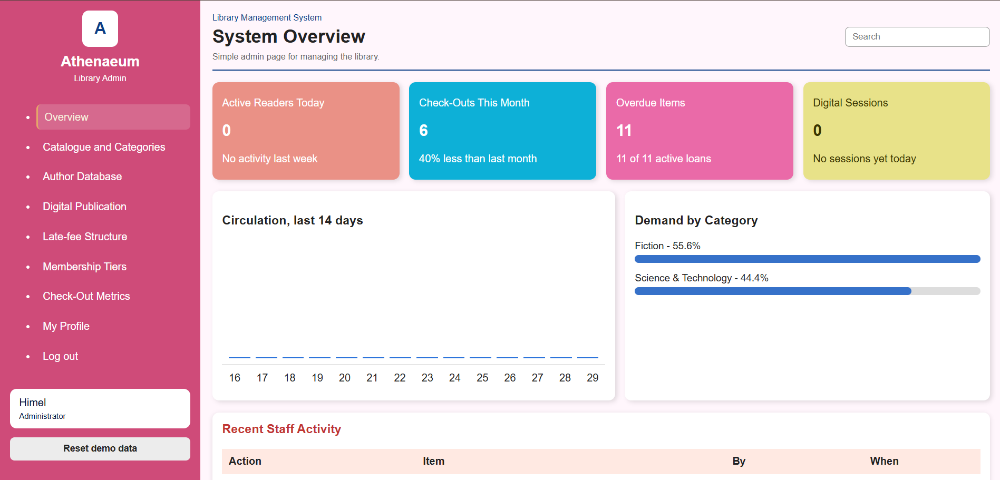
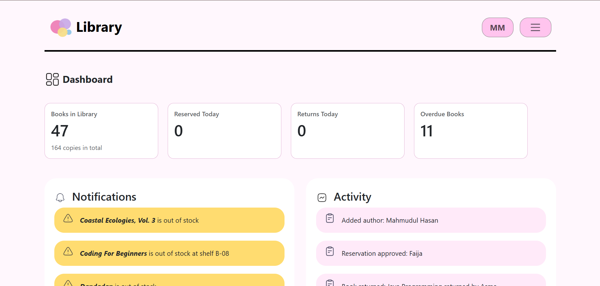

# Library Management System

A role-based web application for managing a library, built with **PHP, MySQL, JavaScript, HTML and CSS**. It has separate interfaces for **Admins**, **Librarians** and **Readers**, all backed by one MySQL database.

> Web Programming course final project.

## Features

**Admin**
- Manage authors, book catalogue and digital editions
- Configure membership plans and late fees
- View library metrics and manage the admin profile

**Librarian**
- Check out and return books
- Track and clear fines
- Manage inventory and reservations
- Dashboard with daily statistics

**Reader / Guest**
- Browse the catalogue and view book details
- Sign up, log in and manage a profile
- Reserve books and book appointments
- Membership plans, study zone, and lend and trade

**General**
- Role-based login with server-side access checks
- Passwords stored with PHP `password_hash()` / `password_verify()`
- New sign-ups are created with the `reader` role only

## Tech Stack

| Layer | Technology |
|---|---|
| Frontend | HTML, CSS, JavaScript |
| Backend | PHP (PDO) |
| Database | MySQL |
| Local server | XAMPP (Apache + MySQL) |

## Screenshots

<!-- Replace with your own screenshots after uploading them to the images/ folder -->
| Admin Dashboard | Librarian Dashboard | Reader Dashboard |
|---|---|---|
|  |  |  |

## Project Structure

```
├── admin/            Admin pages with their CSS and JS
├── AdminPHP/         Admin backend endpoints
├── guest_user/       Guest and Reader pages with their CSS and JS
├── UserPHP/          Login, signup and logout backend
├── librarian/        Librarian pages (html-css/, js/, php/, img/)
├── config/           Database connection and session/role helpers
├── _tests/           Test scripts
├── database.sql      Full schema, sample data and demo accounts
└── fix_demo_accounts.sql   Repair script for demo accounts
```

## Getting Started

### Prerequisites
- [XAMPP](https://www.apachefriends.org/) (Apache and MySQL)

### Installation
1. Clone or download this repository.
2. Copy the folder to `C:\xampp\htdocs\library_management_system_final\`.
3. Start **Apache** and **MySQL** in the XAMPP Control Panel.
4. Open **phpMyAdmin** (`http://localhost/phpmyadmin`) and import `database.sql`.
5. Open `http://localhost/library_management_system_final/` in your browser.

> `database.sql` recreates the `library_db` database. Importing it replaces any existing database with the same name.

### Database configuration
Default XAMPP settings are used in `config/db.php` and `librarian/php/db.php`:

| Setting | Value |
|---|---|
| Host | `localhost` |
| Database | `library_db` |
| Username | `root` |
| Password | *(empty)* |

Update both files if your MySQL credentials are different.

### Demo accounts
Demo accounts for the Admin, Librarian and Reader roles are created by `database.sql`. If login fails on an already-imported database, run `fix_demo_accounts.sql` in phpMyAdmin to repair them.

## Database

The `library_db` database has about 30 tables, including `users`, `books`, `authors`, `categories`, `book_copies`, `loans`, `fines`, `reservations`, `appointments`, `membership_plans`, `reviews` and `notifications`.

## Team

- My Name: Eusa Anjum Himel
- Teammate Name: 1/ Faija Ahamed Mim 2/ Maryum Binte Hossain

## License

This project was created for educational purposes.
